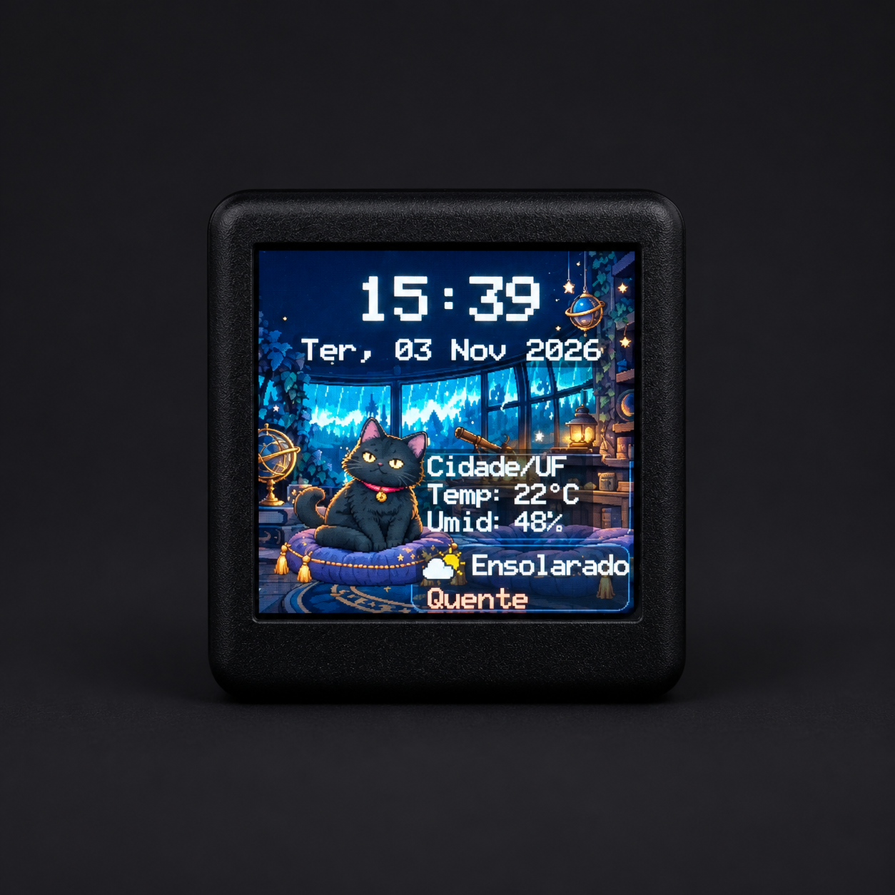
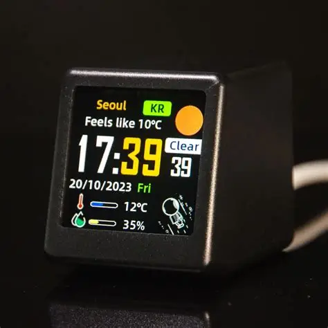

# Neko Weather Clock

**Portfolio de Vibe Coding:** tema climático em português para relógio GeekMagic / SmallTV de 240 × 240 pixels.



| Referência original | Tema Neko |
|---|---|
|  |  |

A imagem do Neko é uma apresentação editada com IA a partir da foto de referência; o fundo e a mão foram removidos e o rótulo da cidade foi generalizado. Os valores mostrados são ilustrativos, não uma leitura ao vivo.

## O que foi feito

- Data e condições do tempo em português, temperatura, umidade relativa e sensação térmica.
- Neko pisca sem deslocar o corpo ou a almofada.
- Chuva animada limitada às janelas, atrás das lanternas, com oscilação sutil de luz.
- Tema mantido no limite de 32 camadas do firmware; esta versão usa 31.
- Construtor Python reproduzível, pacote de tema pronto e configurações locais ignoradas pelo Git.

## Baixar e testar

- [Pacote de tema para importar no relógio](Neko_Clima_BR_Demo.stheme)
- [Projeto completo: fontes, artes, prévias e documentação (ZIP)](Neko_Weather_Clock_Source.zip)
- [Guia completo para IAs e contribuidores](AI_GUIDE.md)

### Reproduzir a compilação

Extraia o ZIP, abra um terminal na pasta do projeto e execute:

```text
python -m pip install -r requirements.txt
python scripts/build_theme.py
```

O arquivo `.stheme` e as prévias serão gerados localmente. Para arquitetura, estrutura dos arquivos, configuração de localização, limites do dispositivo e cuidados de privacidade, consulte o [AI_GUIDE.md](AI_GUIDE.md).

O `.stheme` é apenas um tema visual, não é firmware. Instale em **Display → Theme clocks** em um SmallTV Mod compatível. Faça uma cópia do tema atual antes de trocar.

## Privacidade e segurança

O pacote público usa coordenadas genéricas de demonstração em Brasília. Não inclui IP da rede, MAC do dispositivo, Wi-Fi, número de série nem localização privada. O construtor apenas gera imagens e o arquivo de tema: não se conecta ao relógio, não faz varredura da rede e não grava firmware. O relógio consulta a API pública Open-Meteo para a localização escolhida.

Para compilar um tema para outro local, baixe o ZIP, consulte o `README.md` incluído e personalize `config.local.json`, que fica fora do Git.

## Licenças

Código: MIT. Artes geradas para o projeto: CC BY 4.0. Codificador STI adaptado: WTFPL v2. A imagem de referência GeekMagic foi fornecida pelo responsável pelo projeto e não recebe licença de reutilização. Consulte os avisos dentro do ZIP.

## English summary

An AI-assisted, human-directed Vibe Coding portfolio project: a Portuguese Neko weather theme for a 240×240 ESP8266 SmallTV clock, with a reproducible builder, privacy-safe demo package, and complete source bundle.
